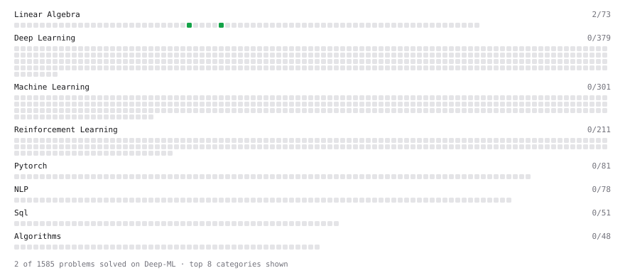

# Deep-ML

My machine learning practice from [Deep-ML](https://www.deep-ml.com). Every solution here was written by hand.

**3** solved · 2 problems · 0 labs · 1 math

[**Browse the interactive portfolio**](https://M-priv.github.io/deep-ml/) to replay this filling in over time.

## Problems

| | Difficulty | Solved | |
| --- | --- | --- | --- |
| [Dot Product Calculator](https://www.deep-ml.com/problems/83) | easy | 2026-10-13 | [solution](problems/0083-dot-product-calculator) |
| [Vector Element-wise Sum](https://www.deep-ml.com/problems/121) | easy | 2026-10-13 | [solution](problems/0121-vector-element-wise-sum) |

## Math

| | Difficulty | Solved | |
| --- | --- | --- | --- |
| [Matrix Multiplication](https://www.deep-ml.com/math-problems/10) | medium | 2026-10-16 | [solution](math/0010-matrix-multiplication) |

---

_This file is regenerated by Deep-ML on every push._
